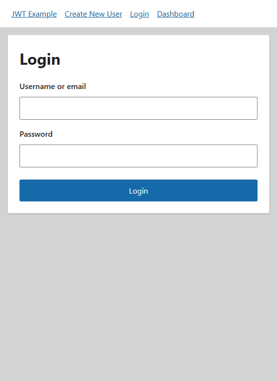

# JWT Example

Register, log in, and call a protected API with a JWT. Built with Node.js, Express, and MySQL.

Requires Node.js 26.13.1+ (26.x) and a running MySQL server.

## 1. Install

```sh
git clone https://github.com/tance77/JWT_Example.git
cd JWT_Example
npm ci
```

## 2. Configure

Copy the settings file and generate a secret:

```sh
cp .env.example .env
node -e "console.log(require('node:crypto').randomBytes(48).toString('hex'))"
```

In `.env`, set `SECRET_KEY` to the generated value and fill in your MySQL `DB_USER` and `DB_PASSWORD`.

## 3. Run

```sh
npm run db:create
npm run db:migrate
npm start
```

Open [localhost:3001](http://localhost:3001). Create a user with a password of at least 8 characters, log in, then click **Get Secure Information**.


